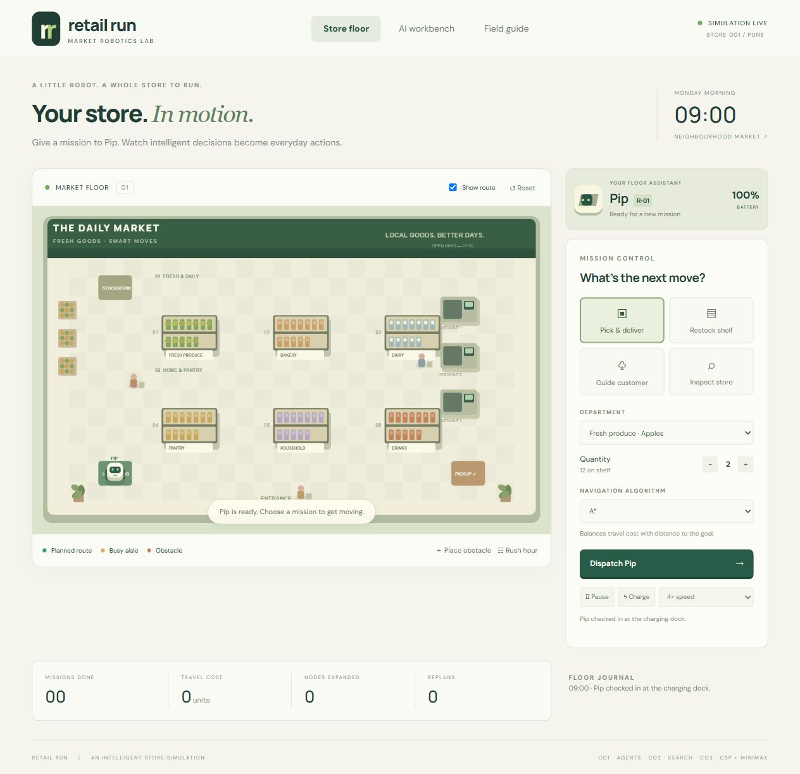

# Retail Run

A browser-based smart retail robot simulation. Open `dist/index.html` directly, or serve `dist` with any static HTTP server. No installation or build step is needed.

## Features

- Canvas supermarket with stocked departments, checkout lanes, robot animation and route overlay.
- Pick and deliver single products or a three-product basket; restock; guide customers; inspect all departments; recharge.
- BFS, DFS, UCS, Greedy Best-First and A*; weighted rush-hour costs; obstacle placement and replanning.
- Inventory conservation, 8 kg payload checks, battery checks, pause, speed controls and deterministic reset.
- AI workbench with live path comparisons, the FA1 graph, CSP robot assignments, and Minimax/Alpha-Beta service scenarios.

Run `node tests.cjs` to verify core algorithms. All simulation data lives in memory and resets on refresh. Fonts use Google Fonts with local fallbacks. The app makes no other external requests.

## Academic scope

Fully visible, four-neighbour discrete grid; each item weighs 1 kg. Normal movement costs 1, rush-hour central cells cost 4. A* uses Manhattan distance. Battery consumes 0.18 percent per travel-cost unit. Search is optimal only for the current snapshot where appropriate. Shoppers are decorative except the guided shopper. CSP and service planning are separate teaching demonstrations, not an integrated multi-robot fleet controller. No real-world performance claims are made.

## Autonomous shifts
Enable Autopilot for continuous orders, low-stock replenishment and charging. Enable Live environment for repeatable temporary blockages. Drop a blockage inserts one ahead of the robot when possible; it clears after 18 simulation seconds. Simulation speed applies to events and missions; pause freezes both. Manual blockages persist until removed or reset. Run `node simulation-tests.cjs` for mission and autonomy checks.

## Project team

- Soham Mulik - 124B1C134
- Rudra Tere - 124B1C127
- Mentor: Prof. Pallavi Nikumbh Dhade
- Pimpri Chinchwad College of Engineering, Pune

## Run the application

Download or clone this repository, then open `dist/index.html` in a browser. There are no dependencies to install. Alternatively, run `python -m http.server 8000 --directory dist` from the repository folder and open http://localhost:8000.

## Verify the project

With Node.js installed, run these commands from the repository folder:

```sh
node tests.cjs
node simulation-tests.cjs
```

## Reports and evaluation

- [Project report](docs/Retail_Run_Project_Report.pdf)
- [Research paper](docs/Retail_Run_Research_Paper.pdf)
- [Recorded evaluation data](evaluation/measurements.json)

The evaluation data records fixed-layout simulated experiments, not real-store measurements. CSP and Minimax are separate demonstrations.


